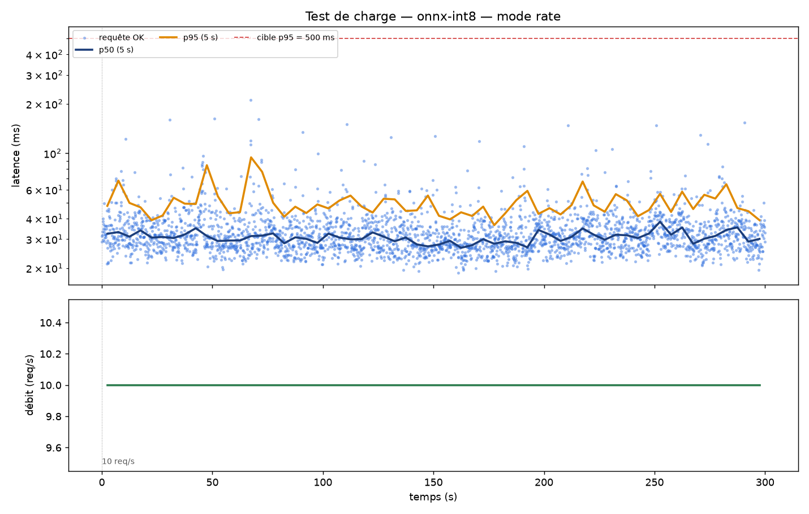
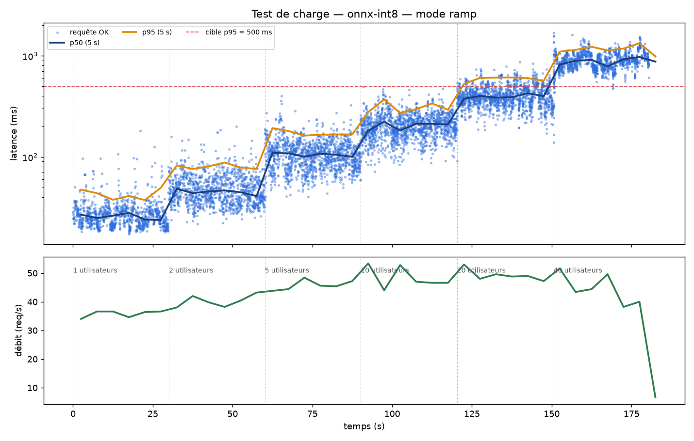

# Itération 5 — Le Flux : preuves

`scripts/load_test.py` simule des vendeurs qui envoient des photos en continu (les 200 images du jeu de test, en boucle), en `asyncio` + `httpx`, authentifiés comme un vrai client. Deux modes :

- **ramp** : paliers d'utilisateurs simultanés (boucle fermée) → trouve le point de saturation ;
- **rate** : débit imposé (boucle ouverte, 10 req/s quoi qu'il arrive) → vérifie le critère de la spec.

Chaque requête est enregistrée (CSV), résumée par palier (JSON) et tracée (PNG). Pendant ces tests, l'API tournait via `docker compose` avec le suivi MLflow actif : les 3 000 requêtes du test à débit constant sont aussi dans le dashboard.

Machine : 2 vCPU partagés **entre l'API et le générateur de charge** (les chiffres sont donc pessimistes).

## Critère de la spec : 10 req/s pendant 5 minutes (image ONNX int8)

| Requêtes | Débit | p50 | p95 | p99 | Erreurs |
| --- | --- | --- | --- | --- | --- |
| 3 000 | 10,0 req/s | 31 ms | **51 ms** | 82 ms | **0 %** |

Cible p95 < 500 ms ✅ (×10 de marge) · cible erreurs < 1 % ✅.



## Montée en charge (image ONNX int8, 2 vCPU)

| Utilisateurs simultanés | Débit | p50 | p95 | Erreurs |
| --- | --- | --- | --- | --- |
| 1 | 35,8 req/s | 26 ms | 44 ms | 0 % |
| 2 | 40,4 req/s | 45 ms | 80 ms | 0 % |
| 5 | 45,9 req/s | 105 ms | 173 ms | 0 % |
| 10 | 48,6 req/s | 201 ms | 308 ms | 0 % |
| 20 | 49,6 req/s | 390 ms | 584 ms | 0 % |
| 40 | 45,1 req/s | 895 ms | 1 209 ms | 0 % |

Le débit plafonne vers **48 req/s** : au-delà, les requêtes font la queue (la latence double quand les utilisateurs doublent) mais l'API ne renvoie aucune erreur. La p95 reste sous 500 ms jusqu'à ~15 utilisateurs simultanés.



## Dimensionnement pour le cloud : 1 vCPU (configuration Cloud Run)

Conteneurs limités à 1 vCPU (`docker run --cpus=1`), comme une instance Cloud Run :

| Simultanés | ONNX int8 (1 Gio) : débit / p50 / p95 | PyTorch fp32 (2 Gio) : débit / p50 / p95 |
| --- | --- | --- |
| 1 | 17,9 req/s · 68 ms · 90 ms | 4,6 req/s · 205 ms · 281 ms |
| 2 | 21,2 req/s · 94 ms · 162 ms | 5,7 req/s · 323 ms · 482 ms |
| 4 | 22,8 req/s · 178 ms · 283 ms | 4,2 req/s · 996 ms · 1 314 ms |
| 8 | 24,1 req/s · 322 ms · 495 ms | 4,2 req/s · 1 887 ms · 2 869 ms |
| 16 | 28,2 req/s · 586 ms · 802 ms | — |

Mémoire en charge : 260 Mo (ONNX) contre 533 Mo (PyTorch).

**Conséquences :**
- Une instance 1 vCPU ONNX absorbe **≈ 23 req/s**, soit **≈ 0,043 vCPU-seconde par image** ; PyTorch ≈ 0,22 vCPU-s, **5× plus cher en calcul**. Ces chiffres alimentent [FINOPS.md](../../FINOPS.md).
- `--concurrency 4` sur Cloud Run (p95 ≈ 280 ms) : au-delà, mieux vaut ajouter une instance que laisser la file s'allonger.

```bash
python scripts/load_test.py --token $API_TOKEN --mode rate --rate 10 --duration 300 --label onnx-int8
python scripts/load_test.py --token $API_TOKEN --mode ramp --users 1,2,5,10,20,40 --step 30 --label onnx-int8
```
