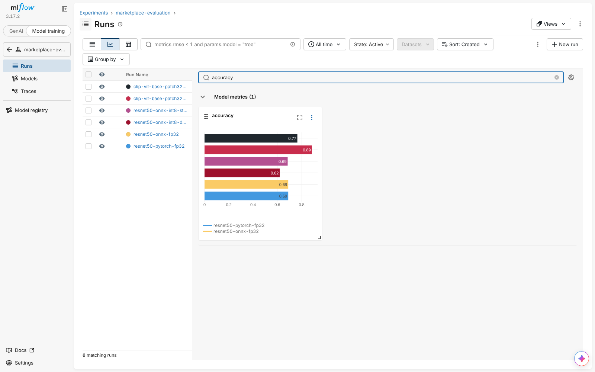
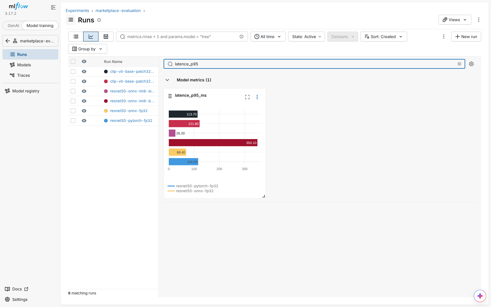
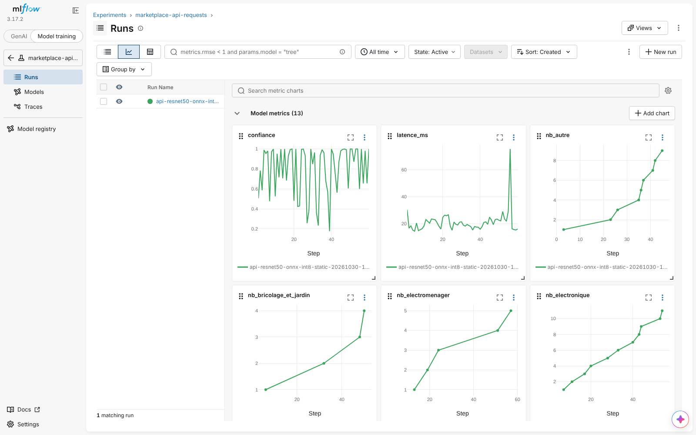

# Itération 8 — Le Rétroviseur : preuves

MLflow suit deux choses, dans deux expériences :

| Expérience | Qui écrit | Contenu |
| --- | --- | --- |
| `marketplace-evaluation` | `scripts/evaluate.py --mlflow`, `scripts/benchmark_clip.py --mlflow` | 1 run par modèle : accuracy, accuracy par catégorie, taux `auto`, précision quand `auto`, latence p50/p95/moyenne, taille du modèle, courbe du seuil |
| `marketplace-api-requests` | l'API elle-même (étape 9 du pipeline, `app/monitoring.py`) | 1 run par instance de l'API : pour **chaque requête**, latence, confiance, statut, compteur par catégorie |

Le suivi des requêtes est asynchrone (file + thread, envoi par lots toutes les 2 s) : MLflow lent ou en panne n'ajoute aucune latence et ne casse pas l'API. En production (URI `http://`), il passe par l'API REST de MLflow en `urllib` : l'image Docker n'embarque pas le paquet `mlflow`, sa taille ne bouge pas (551 Mo). Aucune image, aucun nom de fichier, aucune IP n'est envoyé : uniquement des chiffres.

## Comparaison des modèles (même jeu de 200 photos, même machine)

| Run MLflow | Taille | Accuracy | Précision si `auto` | Taux `auto` | p50 | p95 |
| --- | --- | --- | --- | --- | --- | --- |
| resnet50-pytorch-fp32 (it. 2, lourd) | 97,7 Mo | 69,0 % | 76,8 % | 77,5 % | 82 ms | 116 ms |
| resnet50-onnx-fp32 | 97,4 Mo | 69,0 % | 76,8 % | 77,5 % | 43 ms | 68 ms |
| resnet50-onnx-int8-dynamic | 24,6 Mo | 62,0 % | 76,9 % | 65,0 % | 238 ms | 350 ms |
| **resnet50-onnx-int8-static (it. 4, prod)** | **24,9 Mo** | **68,5 %** | 77,6 % | 78,0 % | **17 ms** | **26 ms** |
| clip-vit-b32 zero-shot, vocabulaire détaillé | 577 Mo | **88,5 %** | **94,6 %** | 83,0 % | 88 ms | 122 ms |
| clip-vit-b32 zero-shot, vocabulaire générique | 577 Mo | 76,5 % | 88,9 % | 67,5 % | 83 ms | 114 ms |

Les latences varient d'environ ±20 % d'une session de mesure à l'autre sur cette machine partagée (comparer l'it. 4) ; les écarts entre modèles, eux, sont stables.

**Optimisation (critère it. 4/8) :** le modèle optimisé perd 0,5 point d'accuracy (≤ 2 ✅), divise la taille par 3,9 (✅) et la latence p50 par 4,7 (✅).

**Lecture métier :** ResNet-50 ImageNet plafonne à ~69 %. CLIP zero-shot fait nettement mieux : +7,5 points avec un vocabulaire « aveugle » de 25 descriptions génériques, +19,5 points avec un vocabulaire détaillé de 165 objets. Le vocabulaire détaillé a été écrit en connaissant les classes sources du jeu de test : **88,5 % est donc une borne optimiste**, et la vraie valeur sur des photos de vendeurs se situe probablement entre 76,5 et 88,5 %. Il faut la confirmer sur un jeu de photos réelles indépendant avant de basculer (décision listée dans `CLAUDE.md`).

Coût de CLIP : modèle 23× plus lourd que ResNet int8 et ~5× plus lent (encore en PyTorch fp32). Prochaine étape si on bascule : exporter **uniquement l'encodeur image** en ONNX int8 et garder les embeddings texte pré-calculés (recommandation du LLM Council).

## Captures du dashboard

Comparaison des runs d'évaluation (accuracy) :



Latence p95 par run :



Historique des requêtes de l'API (latence, confiance, compteurs par catégorie) :



## Reproduire

```bash
# Évaluations -> sqlite:///mlflow.db
python scripts/evaluate.py --backend pytorch --mlflow
python scripts/evaluate.py --backend onnx --onnx-path models/onnx/resnet50-int8-static.onnx --mlflow
python scripts/benchmark_clip.py --mlflow                      # vocabulaire détaillé
python scripts/benchmark_clip.py --vocab generique --mlflow    # contrôle « aveugle »
mlflow server --backend-store-uri sqlite:///mlflow.db --port 5000

# API + MLflow en conteneurs (chaque requête est journalisée)
docker compose up -d --build        # API :8000, MLflow :5000
```
